<div align="center">


*「 継続は力なり 」 — Continuity is strength • Architecting offline-first Android apps & on-device AI*


</div>

```typescript
const rudra = {
  name: "Rudra Bhardwaj (KaranKaliRoot)",
  title: "Computer Science, Edge AI & Native Android Developer",
  philosophy: "一期一会 (Ichigo Ichie) · 継続は力なり (Continuity is Strength)",
  stack: [
    "Python", "Kotlin", "Jetpack Compose", "C++/NCNN",
    "Room / SQLite", "JavaScript", "HTML", "Linux", "Termux"
  ],
  launchedProjects: [
    "Kotoba (言葉) — Offline JLPT N5–N1 Android App",
    "AKARI-1.5B — Custom AI Model That Teaches Japanese",
    "Vision-V4 — 30 FPS Real-Time Android Object Detection",
    "InkTwin — Android Application",
    "80+ Independent Python Projects"
  ],
  humanLanguages: ["English", "Hindi", "日本語 (JLPT N4)"],
  status: "Building 100% offline mobile apps & edge AI inference engines on Android",
  openTo: ["Native Android (Kotlin/Compose)", "Computer Vision", "Edge / On-Device AI"]
};
```

<div align="center">


</div>

<!--LIVE:START-->
<!--LIVE:END-->

<div align="center">


<a href="https://github.com/KaranKaliRoot/Kotoba-japanese-"></a>

</div>

A 100% offline, native Android application built with **Kotlin** and **Jetpack Compose** covering **JLPT N5 through N1**. Designed around the structured study philosophy of *Nihongo Sou Matome* and *Shin Kanzen Master* with an editorial Japanese *Kinari* aesthetic and bento-grid dashboard.

| Layer | Technology & Mechanics |
| :--- | :--- |
| **UI & Architecture** | Kotlin, Jetpack Compose (Material 3), MVVM Clean Architecture, Editorial Bento UI |
| **Kanji Stroke Engine** | [KanjiVG](https://kanjivg.tagaini.net/) vector SVG path parser with directional cosine & corridor validation |
| **SRS & Curriculum** | Anki SM-2 Spaced Repetition Flashcards, N5–N1 Master Word List, Grammar Nuance Drills |
| **Reading & Widget** | Interactive Story Reader (Furigana + Tap-to-Lookup Dictionary) & Hourly Jetpack Glance Widget |
| **Local Persistence** | Room SQLite Database (`KotobaDatabase`), Preferences DataStore, WorkManager |

[💻 Source Code (`KaranKaliRoot/Kotoba-japanese-`)](https://github.com/KaranKaliRoot/Kotoba-japanese-)

<div align="center">

<a href="https://github.com/KaranKaliRoot/AKARI-1.5B"></a>

</div>

My own AI model built to teach Japanese, released as a GGUF file and published on GitHub.

| Layer | Technology |
| :--- | :--- |
| **Domain** | Japanese Language Learning, Conversational AI |
| **Model Format** | GGUF (tracked with Git LFS) |
| **Tooling** | Python (data seeding, migration & verification scripts) |

[💻 Source Code (`KaranKaliRoot/AKARI-1.5B`)](https://github.com/KaranKaliRoot/AKARI-1.5B)

<div align="center">

<a href="https://github.com/KaranKaliRoot/VisionV4"></a>

</div>

An offline object-detection system that runs directly on Android with no cloud inference. It uses an optimized NCNN pipeline to detect objects from a live camera feed at up to 30 FPS.

| Layer | Technology |
| :--- | :--- |
| **Languages** | Python, C++ |
| **Inference** | NCNN, YOLO |
| **Domain** | Computer Vision, Real-Time Edge Object Detection |
| **Environment** | Linux / Termux on Android |

[💻 Source Code (`KaranKaliRoot/VisionV4`)](https://github.com/KaranKaliRoot/VisionV4)

<div align="center">

<a href="https://github.com/KaranKaliRoot/InkTwin"></a>

</div>

An Android application, published on GitHub.

[💻 Source Code (`KaranKaliRoot/InkTwin`)](https://github.com/KaranKaliRoot/InkTwin)

<div align="center">


<a href="https://github.com/KaranKaliRoot"></a>


<a href="mailto:rudrabhardwaj068@gmail.com"></a>
<a href="https://github.com/KaranKaliRoot"></a>


</div>
